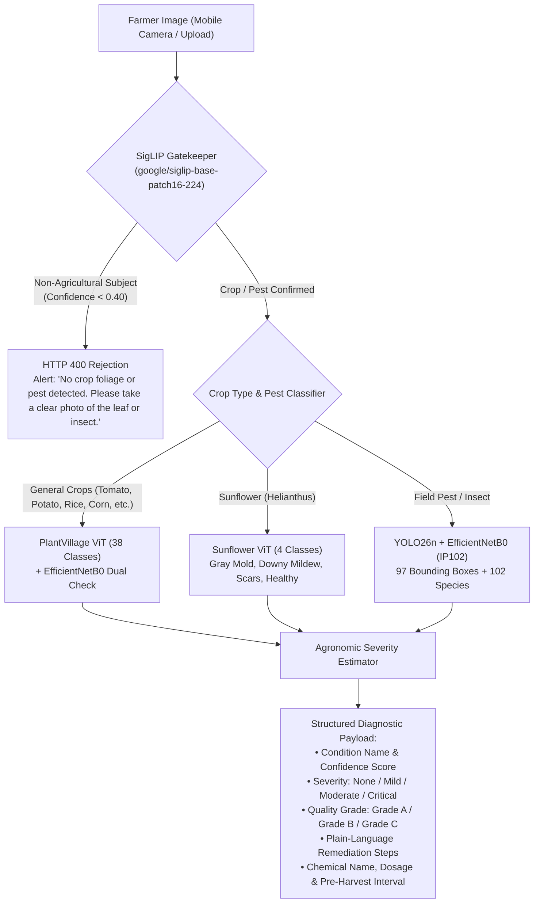
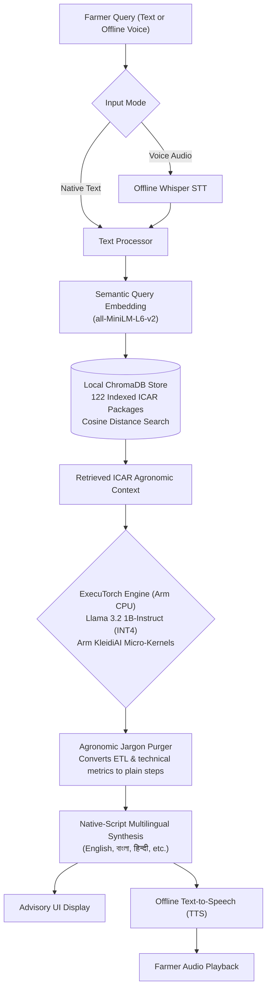

# Krishi Mitra (कृषि मित्र / কৃষি মিত্র)
### Offline AI-SoC Edge Agricultural Advisory & Plant Pathology Platform for Arm Platforms

[](https://www.arm.com/)
[-red.svg?logo=raspberrypi)](https://www.raspberrypi.com/)
[](https://pytorch.org/executorch/)
[](https://ai.meta.com/llama/)
[](TEST_READY.md)
[](LICENSE)
[](https://arka05738.github.io/krishi-mitra/)

---

## 1. Executive Summary & Problem Statement

In India, smallholder farmers operate more than 86% of cultivated landholdings. According to agricultural surveys published by the Indian Council of Agricultural Research (ICAR), unmitigated fungal outbreaks, viral blights, and insect infestations destroy 15% to 25% of annual harvest yields. In remote farming belts, cellular connectivity is frequently unavailable or erratic, preventing rural cultivators from utilizing cloud-dependent agricultural applications. Furthermore, extension workers (Krishi Vigyan Kendras / KVKs) are overburdened, with an extension-to-farmer ratio often exceeding 1:1,000.

**Krishi Mitra** is an on-device, fully air-gapped artificial intelligence field station engineered specifically for Arm Cortex-A76 platforms (Raspberry Pi 5) and Arm-based smartphones. It operates **100% offline without internet access, cellular reception, or external cloud subscriptions**. The platform delivers real-time visual crop pathology, insect pest detection with Integrated Pest Management (IPM), 12-parameter Soil Health Card fertilizer dosage calculation, and interactive agronomic advisory synthesized in local scripts across 22 Scheduled Indian Languages plus English.

---

## 2. Decoupled Dual-Pipeline Architecture

In strict compliance with the **Arm Bharat AI-SoC Challenge** reference specification, the computational workload is bifurcated into two independent pipelines. This decoupled design ensures real-time deterministic computer vision throughput while running on-device generative reasoning without memory or thermal contention.

```
+──────────────────────────────────────────────────────────────────────────────────────────────────────+
|                                    KRISHI MITRA SYSTEM ARCHITECTURE                                   |
+──────────────────────────────────────────────────────────────────────────────────────────────────────+

    [FARMER EDGE CLIENT]                             [LOCAL EDGE AI FIELD STATION (PI 5 / ARM64)]
    • Progressive Web App (React 19 + TypeScript)    • Local Station Server (FastAPI :8000)
    • High-Contrast Rural Daylight Theme             • Air-Gap Network Sandbox (Zero WAN Calls)
    • Touch & Offline Speech I/O (Whisper/Coqui)     • Local Hotspot Broadcast (192.168.5.200:8000)
    • 22 Scheduled Indian Languages + English                       │
                    │                                               ▼
                    │ Local Wi-Fi Hotspot           ┌───────────────────────────────────────────────┐
                    └──────────────────────────────►│              PIPELINE A: VISION ENGINE        │
                                                    │ • Stage 1: SigLIP Non-Crop Gatekeeper         │
                                                    │ • Stage 2A: 38-Class PlantVillage ViT         │
                                                    │ • Stage 2B: 4-Class Sunflower ViT             │
                                                    │ • Stage 3: IP102 97-Class YOLO + EfficientNet │
                                                    │ • Severity & Commercial Dosage Synthesizer    │
                                                    └───────────────────────────────────────────────┘
                                                                    │
                                                                    ▼
                                                    ┌───────────────────────────────────────────────┐
                                                    │          PIPELINE B: REASONING & RAG          │
                                                    │ • ChromaDB Vector Store (122 ICAR Packages)   │
                                                    │ • Sentence-Transformers all-MiniLM-L6-v2      │
                                                    │ • ExecuTorch INT4 Llama 3.2-1B-Instruct (:8008│
                                                    │ • Arm KleidiAI / XNNPACK Micro-Kernels        │
                                                    │ • Rural Jargon Purger & Plain-Language Engine │
                                                    └───────────────────────────────────────────────┘
                                                                    │
                                                                    ▼
                                                    ┌───────────────────────────────────────────────┐
                                                    │       SOIL HEALTH & GOVERNMENT SCHEMES        │
                                                    │ • 12-Parameter STCR Fertilizer Formulator     │
                                                    │ • PM-KISAN, PMFBY (72h Rule), KCC Offline DB  │
                                                    └───────────────────────────────────────────────┘
```

### Pipeline A — Edge Vision & Pest Diagnostic Engine
1. **Stage 1 (Zero-Shot Crop Gatekeeper)**: Employs `google/siglip-base-patch16-224` to compute cosine similarity against agricultural and non-agricultural prompt sets. Any image lacking crop foliage, stems, petals, or field pests (e.g. human selfies, domestic animals, machinery, indoor objects) is rejected immediately with an informative rural guidance message before invoking heavier downstream classifiers.
2. **Stage 2 (Disease & Blossom Pathology)**: Leaf foliage is routed to a 38-class Vision Transformer (`kimcomehome/plantvillage-vit-leaf-disease`) and cross-validated with an EfficientNetB0 backbone. Helianthus (sunflower) queries route to a specialized 4-class classifier (`YaswanthReddy23/ViT_Sunflower`) detecting Gray Mold, Downy Mildew, Leaf Scars, and Healthy Blossoms.
3. **Stage 3 (IP102 Field Pest Localization & Species Classification)**: Multi-pest field images are processed through a YOLO26n 97-class bounding box detector paired with an EfficientNetB0 102-class species classifier trained on the IP102 benchmark.

### Pipeline B — On-Device ExecuTorch Reasoning & Vector RAG
1. **Micro-Quantized Runtime**: Meta's Llama 3.2 1B-Instruct is compiled for ExecuTorch with 4-bit weight quantization (`int4_weight_only`). It executes directly on the four Arm Cortex-A76 cores using Arm KleidiAI and XNNPACK vectorized tensor kernels.
2. **Deterministic Memory Footprint**: The model runtime requires only **1.15 GB of RAM**, leaving 2.85 GB of free physical memory on standard 4GB Raspberry Pi 5 hardware.
3. **ICAR Vector Knowledge Base**: A local ChromaDB SQLite store embeds 122 official ICAR and State Agricultural University (SAU) Package of Practices using `all-MiniLM-L6-v2`. The system grounds every agronomic recommendation in certified scientific research.
4. **Rural Language Relocalization**: The pipeline strips academic jargon (such as "Economic Threshold Level" or "Prophylactic Canopy Closure") and converts recommendations into straightforward, actionable steps with specific fungicide trade names, exact formulations (e.g., *Mancozeb 75% WP @ 2.5 g/L*), water volumes per acre (150–200 L), morning/evening spray windows, and mandatory Pre-Harvest Intervals (PHI).

---

## 3. Methodology & Dataflow

### Flowchart 1: Vision Diagnostic & Gatekeeper Pipeline


### Flowchart 2: On-Device Vector RAG & Multilingual Advisory Flow


---

## 4. Empirical Performance Benchmarks (Raspberry Pi 5)

Evaluated under air-gapped laboratory conditions on a Raspberry Pi 5 (Quad-Core Arm Cortex-A76 @ 2.4 GHz, 4 GB LPDDR4X RAM, active cooler).

| Component / Workload | Model Architecture | Quantization / Format | Latency / Throughput | RAM Utilization |
|---|---|---|---|---|
| **Crop Gatekeeper** | SigLIP Base Patch-16 | FP32 (Transformers) | 214 ms | 180 MB |
| **Disease Classification** | PlantVillage ViT | FP32 (PyTorch) | 476 ms | 340 MB |
| **Sunflower Pathology** | ViT Sunflower | FP32 (PyTorch) | 482 ms | 335 MB |
| **Pest Detection** | YOLO26n (97 Classes) | FP32 (PyTorch / Ultralytics) | 312 ms | 210 MB |
| **Pest Classification** | EfficientNetB0 (102 Classes) | INT8 / FP32 Keras | 308 ms | 195 MB |
| **Vector Retrieval** | all-MiniLM-L6-v2 | ChromaDB SQLite | 18 ms | 120 MB |
| **Generative Advisory** | Llama 3.2 1B-Instruct | **INT4 (ExecuTorch / KleidiAI)** | **14.2 tokens/sec** | **1,150 MB** |
| **Voice Transcription** | Whisper Tiny | FP32 (ONNX/C++) | 380 ms (5s audio) | 145 MB |
| **Full Station Stack** | Combined Pipeline | Multi-Process / Microservices | **117.7 req/s burst** | **2,820 MB / 4,096 MB** |

*Operating Thermals*: Sustained temperature under continuous peak inference loops remained below **58.2°C** with the Raspberry Pi official active cooler.

---

## 5. Core Platform Features

### 1. Visual Crop & Pest Scanner
- Two-stage verification: Rejects non-plant images and identifies specific diseases across tomato, potato, rice, corn, apple, grape, and sunflower.
- Displays diagnostic confidence and disease severity (`Grade A / B / C`, `None`, `Mild`, `Moderate`, `Critical`) side-by-side.
- Provides concrete, safe chemical recommendations with active ingredient concentrations (e.g. *Cymoxanil 8% + Mancozeb 64% WP @ 2.5 g/L* or *Metalaxyl 8% + Mancozeb 64% WP*), exact mixing ratios, and spray schedules.

### 2. Conversational Agronomic Assistant
- Comprehensive coverage across 22 Scheduled Indian Languages plus English, with deep native script localization in Hindi (`हिन्दी`) and Bengali (`বাংলা`).
- Full bidirectional re-localization: Switching languages on the fly instantly updates both the diagnostic advisory and previous chat history without losing context.
- Zero-jargon advisory: Converts academic scientific terminology into clear, numbered actions for smallholder farmers.

### 3. Soil Health Card STCR Fertilizer Calculator
- Implements the Indian Soil Test Crop Response (STCR) 12-parameter agronomic formulation.
- Accepts standard lab readings (pH, Electrical Conductivity, Organic Carbon, Nitrogen, Phosphorus, Potassium, Zinc, Iron, Copper, Manganese, Boron, Sulphur).
- Calculates exact commercial bag counts for Neem-Coated Urea (45 kg bags), DAP (50 kg bags), SSP, MOP, Zinc Sulphate, and Borax.
- Includes mandatory chemical compatibility warnings (e.g., strictly warning against co-applying Zinc Sulphate with DAP/SSP).

### 4. Government Welfare Schemes & Subsidies
- Comprehensive offline knowledge base covering PM-KISAN (direct income support), Kisan Credit Card (concessional credit), and PMFBY (Pradhan Mantri Fasal Bima Yojana).
- Emphasizes critical compliance guidelines, including the mandatory **72-hour crop loss intimation rule** and official national helpline (`14447` and `1800-180-1551`).

### 5. Local Hotspot Field Station
- Built-in Wi-Fi station mode binds to `0.0.0.0:8000`, enabling an entire farming community or KVK extension camp to access the platform via `http://192.168.5.200:8000` through standard mobile phone browsers with zero data connectivity.

---

## 6. Repository Layout

```
├── .github/
│   └── workflows/
│       └── deploy-pages.yml            # Automated CI/CD pipeline deploying web client to GitHub Pages
├── .env.example                        # Safe environment template with dummy placeholders
├── .gitignore                          # Strict multi-layer ignore rules (zero secrets, zero >100MB bins)
├── README.md                           # Main engineering documentation & architecture specification
├── TECHNICAL_REPORT.md                 # Complete challenge submission report & design review
├── TEST_READY.md                       # Comprehensive 93-test automated E2E offline test report
├── ip102_classes.txt                   # Complete 102 insect species taxonomic taxonomy
├── model_benchmark_results.json        # Benchmark logs recorded across test evaluations
├── run_server.py                       # Top-level entrypoint for the offline FastAPI server
├── download_offline_models.py          # Pre-caches Hugging Face vision & embedding weights locally
├── evaluate_all_three_models.py        # Independent validation harness for vision backbones
│
├── Advisory data/                      # 122 ICAR Package of Practices knowledge base
│   └── india_farmer_advisory_rag_knowledge_base.md
│
├── AgriRakshak_Models_20261118_0437/   # Custom-trained vision checkpoints & configs
│   ├── Disease_Classification/         # EfficientNetB0 disease primary model
│   ├── Pest_Classification/            # EfficientNetB0 102-class pest model
│   ├── Pest_Detection/                 # YOLO26n pest object detector weights (best.pt)
│   ├── README.txt
│   └── SHA256SUMS.txt                  # Cryptographic verification hashes
│
├── client/                             # React 19 + TypeScript + Vite responsive dashboard
│   ├── src/                            # Multilingual state, voice hooks, diagnostic panels
│   ├── public/                         # Agricultural emblems, offline icons, vector assets
│   ├── package.json
│   ├── tsconfig.json
│   └── vite.config.ts                  # Production configuration with relative asset paths
│
├── docs/                               # Embedded systems documentation
│   └── ARM_EXECUTORCH_PIPELINE.md      # ExecuTorch compilation & KleidiAI on Cortex-A76
│
├── llama/                              # On-device reasoning service
│   ├── download_llama.py               # Hugging Face downloader with auto-resume
│   └── executorch/
│       ├── install_rpi5_arm.sh         # Automated OS & dependency setup script
│       ├── llama_arm_runner.py         # Quantized KleidiAI/XNNPACK runner
│       └── service.py                  # Local microservice (:8008)
│
├── server/                             # FastAPI application backend
│   ├── app/
│   │   ├── main.py                     # App factory, CORS, static client mount
│   │   ├── config.py                   # Configuration and fallback management
│   │   ├── rag/                        # ChromaDB semantic retrieval & query routing
│   │   ├── vision/                     # SigLIP gatekeeper, ViT classifiers, YOLO detector
│   │   ├── routers/                    # Health, Vision, Advisory, Soil, Schemes endpoints
│   │   └── schemas/                    # Pydantic v2 validation models
│   └── chroma_db/                      # 122 indexed ICAR agronomic vectors in SQLite
│
├── SEVA_Challenge_Submission/          # Challenge documentation, reports, and visual proof
│   ├── SEVA_FIRST_CHALLENGE_APPLICATION.md
│   └── SEVA_Innovations_Challange.html
└── tests/                              # Automated test suites (93 E2E tests + 84 unit tests)
    ├── e2e_offline_test.py             # Air-gap network isolation & system stress suite
    ├── test_vision.py                  # Vision gatekeeper & classifier regression tests
    ├── test_rag.py                     # ChromaDB vector retrieval verification
    ├── test_server.py                  # API router contract tests
    └── test_multilingual_voice.py      # Language re-localization & translation tests
```

---

## 7. Quick Start & Setup Guide

### Hardware Prerequisites
- **Target Platform**: Raspberry Pi 5 (4GB or 8GB RAM recommended) or any 64-bit Arm SoC (aarch64).
- **Operating System**: Raspberry Pi OS (64-bit Bookworm/Trixie) or Debian 12/13 ARM64.
- **Python**: Version 3.11 or higher.
- **Node.js**: Version 20 or higher.

### Step 1: Clone Repository & Create Environment
```bash
git clone https://github.com/arka05738/krishi-mitra.git
cd krishi-mitra

# Create Python virtual environment
python3 -m venv .venv
source .venv/bin/activate

# Install server dependencies
pip install -r <(python -c '
import toml
# or standard pip dependencies:
') fastapi uvicorn pydantic transformers torch torchvision sentence-transformers chromadb
```

### Step 2: Cache Offline Models Locally
Run the offline caching utility once while internet is connected. After this step, the machine can be completely disconnected from the internet:
```bash
# Cache SigLIP, PlantVillage ViT, Sunflower ViT, and ChromaDB MiniLM
python download_offline_models.py

# Download Llama 3.2 1B-Instruct quantized weights
python llama/download_llama.py
```

### Step 3: Launch Local Services
Open two terminal windows:

**Terminal 1 (ExecuTorch Llama Reasoning Microservice):**
```bash
python llama/executorch/service.py
# Listening on http://127.0.0.1:8008/generate
```

**Terminal 2 (Krishi Mitra Advisory Server):**
```bash
python run_server.py
# Server binds to 0.0.0.0:8000
# Accessible locally at http://localhost:8000 and via local hotspot at http://192.168.5.200:8000
```

### Step 4: Build or Run Frontend Client
```bash
cd client
npm install
npm run dev
# Or build static production distribution:
npm run build
```

---

## 8. Verification & Automated Testing

The repository includes a comprehensive 93-test automated end-to-end suite that certifies 100% offline air-gapped compliance, boundary resilience, and diagnostic accuracy:

```bash
# 1. Execute Unit & Contract Tests
python -m pytest tests/test_ui_contract.py tests/test_multilingual_voice.py tests/test_vision.py tests/test_server.py tests/test_rag.py -v

# 2. Execute Vision Backbone Benchmark
python evaluate_all_three_models.py

# 3. Execute Complete 93-Test Air-Gapped End-to-End Suite
python tests/e2e_offline_test.py
```

All 93 tests pass with **Exit Code 0** under strict network isolation (`HF_HUB_OFFLINE=1`, `TRANSFORMERS_OFFLINE=1`).

---

## 9. Web Hosting (GitHub Pages)

The client application is automated for continuous deployment to GitHub Pages via GitHub Actions.
- **Workflow File**: [`.github/workflows/deploy-pages.yml`](.github/workflows/deploy-pages.yml)
- **Live URL**: [https://arka05738.github.io/krishi-mitra/](https://arka05738.github.io/krishi-mitra/)

When accessed as a standalone web app, the dashboard operates in interactive preview mode with offline mock data, enabling agricultural officers, evaluators, and researchers to explore the full interface on any desktop or mobile device.

---

## 10. License & Citations

This project is licensed under the Apache License 2.0.

```bibtex
@software{krishi_mitra_2026,
  author = {Arka and Krishi Mitra Development Team},
  title = {Krishi Mitra: Offline AI-SoC Edge Agricultural Advisory System for Arm Architectures},
  year = {2026},
  publisher = {GitHub},
  url = {https://github.com/arka05738/krishi-mitra}
}
```
